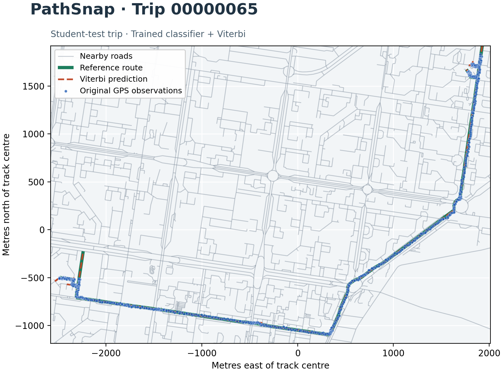

# PathSnap: Technical Report (DRAFT)

> **Working draft assembled by Person 4.** Structure follows the professor's Deliverables document (plan.md Appendix A).
> Rules for everyone filling this in:
> - Every number must come from a real run and name its source file in `results/` (or the command that produced it).
> - State which partition (train / student_test) every analysis uses.
> - No fabricated metrics, graphs or citations. Write answers from your own experiments.
> - Results produced with the MOCK scorer are NOT reportable.
> - Put figures in `report/figures/` and screenshots in `report/screenshots/`.

**Team:** _names_  ·  **Course:** UE24CS352A Machine Learning, PES University  ·  **Repository:** https://github.com/priyaakl/ML_Hackathon

---

## 1. Overview *(Person 4)*

PathSnap reconstructs the road route behind a noisy GPS trajectory. For each GPS point, nearby road arcs are generated as candidates and described by features. A classifier scores each candidate, and an HMM with Viterbi decoding selects the most likely connected sequence of arcs. The system is served by a FastAPI backend (Laptop 1) and used through a Streamlit UI (Laptop 2).

_Pipeline diagram: to add._

---

## 2.2 Dataset Understanding and EDA *(Person 1)*

**(1) How did you preprocess the data?**
_TODO (Person 1): file parsing, per-trip local projection (src/common/geo.py) and why, label alignment by monotone DP (src/data/labels.py), label_valid threshold (50 m), handling of broken reference routes (trips 00000033, 00000054)._

**(2) What patterns did you observe, what features did you extract, and why?**
_TODO (Person 1): use results/eda_summary.csv, results/eda_network.csv, results/label_quality.csv, results/candidate_stats.csv. Explain each of the 20 features in models/feature_columns.json._

Required content:
- [ ] Missing-value analysis (partition stated)
- [ ] GPS trajectory plots
- [ ] Road-network visualisations
- [ ] At least one Folium map (screenshot)
- [ ] Figures from results/figures/: fig_trip_lengths, fig_time_gaps, fig_speed, fig_candidates, fig_label_distance

---

## 3. Model Experimentation *(Person 2)*

### 3.1 Overall model comparison

Source: `results/experiments.csv`

| Model | Algorithm Family | Key Configuration | CV Macro F1-score | Top-1 Accuracy | Route continuity | Student-Test Macro F1-score | Log Loss | Inference Time |
|---|---|---|---|---|---|---|---|---|
| Model 1 | | | | | | | | |
| Model 2 | | | | | | | | |
| Model 3 | | | | | | | | |
| Model 4 | | | | | | | | |
| Model 5 | | | | | | | | |

Metric definitions used in this table _(Person 2 to confirm)_: Top-1 = observation level over valid labels; Macro F1 = candidate-level, threshold 0.5, mean of F1(class 0) and F1(class 1).

### 3.2 Per-model questions (one subsection per model)

#### Model N: _name_
- **A1.** Why did you consider this algorithm suitable for PathSnap?
- **A2.** Major strengths and limitations for this task?
- **B5.** Important hyperparameters and their initial values?
- **B6.** Loss function or optimisation objective?
- **C7.** Performance on the student-testing dataset?
- **C8.** Observation-level Top-1, Macro F1 and Log Loss on student-test?
- **C9.** Overfitting or underfitting? Evidence?

_(The professor's list is numbered 1, 2, 5, 6, 7, 8, 9. Questions 3 and 4 were not in our copy; asked the TA: _answer_.)_

### 3.3 Visualisations
- [ ] CV macro F1 comparison across all models
- [ ] Student-test Top-1 and macro F1 comparison
- [ ] Log loss comparison
- [ ] Training/validation curves ONLY for models with real epoch histories
- [ ] Plots justifying the final model choice

---

## 4. Bayesian Hyperparameter Optimisation *(Person 2)*

1. Hyperparameters searched: _TODO_
2. Ranges / distributions: _TODO_
3. Objective function: _TODO_
4. Number of trials: _TODO_
5. Best values: _TODO_
6. Did the tuned model beat the untuned one? _TODO_

| | CV Macro F1 | Student-Test Top-1 | Student-Test Macro F1 | Log Loss | Inference Time |
|---|---|---|---|---|---|
| Untuned | | | | | |
| Tuned | | | | | |

---

## 5. HMM and Viterbi Route Reconstruction *(Person 3)*

1. **Hidden states.** A state is a candidate directed road segment for one GPS observation. Person 1's pipeline supplies up to 20 candidates within 40 m.
2. **Emission score.** The decoder uses the log of the classifier's probability for each GPS–road pair.
3. **Transition score.** It compares the straight-line movement between GPS readings with directed road-network distance from a bounded Dijkstra search. A larger mismatch receives a larger penalty. Viterbi combines both scores across observations and traces back the best sequence.
4. **Missing candidates and GPS gaps.** An observation with no candidates carries the previous decoded arc forward, when available. The first missing observations use `-1`. A GPS gap over 30 seconds starts a new sequence.
5. **Disconnected segments.** If the search fails to find a route within its cap, the decoder applies a finite penalty. The network search is capped at 250 m.

We compared transition scales of 15, 30, and 60 m and disconnected-transition penalties of 4 and 8 on eight training trips. The best pooled training accuracy came from 60 m and a penalty of 4. The deployed decoder configuration records these training-selected settings. The classifier was fitted on these training trips. Source [hmm_tuning_summary.csv](../results/hmm_tuning_summary.csv).

### Student-test comparison

The classifier was the logistic-regression model supplied with this project snapshot. The three methods used identical candidate scores across ten student-test trips, with 19,133 valid reference assignments out of 19,160 GPS observations.

| Method | Top-1 accuracy | Macro F1 (arc-level) | Route continuity | Sequence similarity |
|---|---:|---:|---:|---:|
| Classifier only | 86.60% | 77.96% | 95.30% | 65.27% |
| Classifier + default Viterbi | 88.84% | 85.50% | 99.12% | 85.43% |
| Classifier + training-tuned Viterbi | 88.52% | 84.97% | 98.74% | 82.59% |

Top-1 pools matches across valid GPS observations. Arc-level macro F1 averages F1 across road segments within each trip, then averages the trip scores. Route continuity measures repeated arcs or directed connections within two steps. Sequence similarity is one minus normalized edit distance after collapsing consecutive duplicate arc IDs. Continuity and sequence similarity are averaged across trips. Source [hmm_student_test_summary.csv](../results/hmm_student_test_summary.csv).

Training-tuned Viterbi improved pointwise accuracy on nine of ten trips compared with classifier-only matching. The original Viterbi settings scored slightly higher overall on student test. On trip `00000007`, tuned decoding improved continuity from 99.70% to 100.00% while pointwise accuracy fell from 88.48% to 85.52%. It repaired four classifier misses and introduced 44 wrong assignments. Source [hmm_student_test_by_trip.csv](../results/hmm_student_test_by_trip.csv).

---

## 6. Geographical Visualisation Using Folium *(Person 3)*

The map for student-test trip `00000065` shows raw GPS points in blue, nearby roads in grey, the reference route in green, and the Viterbi prediction in dashed orange. The interactive Folium map includes layer controls and zoom. The figure below is a static export of the same four layers. The reference layer is included for this report figure. The evaluator UI receives the predicted route and aggregate metrics.

The interactive file is generated under `results/maps/` by running `python -m src.hmm.compare --map-trip 00000065` with the student dataset configured. Map generation is implemented in `src/viz/folium_maps.py`.

---

## 7. API, UI and Deployment *(Person 4)*

### 7.1 Architecture

Two laptops on the same local network:

- **Laptop 1 (server):** FastAPI backend (`src/api/main.py`) runs the full pipeline: candidate generation (Person 1), classifier scoring (Person 2's `CandidateScorer`), HMM/Viterbi decoding (Person 3's `decode_trip`) and server-side evaluation (`src/api/evaluator.py`). It holds the dataset, model and reference routes.
- **Laptop 2 (client):** web UI (`src/ui/web/index.html`, served by `src/ui/serve.py`) with a Leaflet map. It holds no data and no model, and talks to Laptop 1 only over HTTP from the browser (CORS enabled on the API).

### 7.2 Backend

| Endpoint | Description |
|---|---|
| `GET /health` | Liveness check; reports the loaded scorer, decoder and decoder-parameter source |
| `GET /trips` | Trip ids in the configured evaluation folder |
| `POST /predict` | Body `{"trip_id": ...}`. Runs the pipeline, then evaluates. Returns predicted arcs (HMM and classifier-only), GPS points, route geometry, per-stage timing and summary metrics |

Design decisions:
- **Load once at startup:** the model is loaded and every trip's road graph is built when the server starts, not on each request.
- **Configuration, not hardcoding:** host, port, CORS origins, the trips folder and the UI's API address come from `config.yaml`, with environment-variable overrides (`PATHSNAP_EVAL_DIR`, `PATHSNAP_API_URL`).
- **Request logging:** each request logs the caller's IP, the trip id, the number of GPS points and candidates, time per stage, Top-1 (HMM vs classifier-only) and total time.
- **Validation and errors:** request and response schemas are enforced with Pydantic. An unknown trip returns 404, a malformed body 422, and a pipeline failure 500 with the error logged. If evaluation fails, the route is still returned.
- **Same candidate settings as training:** the live API calls `build_candidates_for_trip` with the radius and cap from `config.yaml`, so features match training.

### 7.3 Ground truth stays server-side
The prediction pipeline (`src/api/pipeline.py`) reads only `.track`, `.nodes` and `.arcs`. After prediction, `src/api/evaluator.py` reads the `.route` file on Laptop 1, aligns it to GPS points with Person 1's `label_trip()` (the same labelling used for training), excludes unreliable labels (`label_valid == False`) and returns only summary metrics. Reference arcs are never sent to the UI.

### 7.4 UI
_Describe and show:_ backend connection status (scorer and decoder in use), trip selector, Match route button with live elapsed-time indicator, Top-1 headline, HMM vs classifier-only bars for Top-1, macro F1 (arc-level) and route continuity, per-stage timing on Laptop 1, a log of every API request the page made, and an interactive map (predicted route over the GPS points, no reference layer).

### 7.5 Deployment test
- Network used: _hotspot / Wi-Fi_
- Laptop 1 IP: _x.x.x.x_ · Port: 8000 · Laptop 2 OS: _..._
- Firewall settings: _..._
- Result: all 10 trips predicted from Laptop 2. Per-trip request time: _from results/api_eval_student_test.csv / logs_

### 7.6 Screenshots *(final model only, MOCK banner must NOT be visible)*
- [ ] UI on Laptop 2 after a prediction (map + metrics)
- [ ] Laptop 1 terminal showing request logs from Laptop 2's IP
- [ ] Successful `/predict` response on the receiving laptop's terminal

---

## AI Assistance Statement *(all)*

_TODO: honest description of how AI tools were used, per the event policy. Format confirmed with TA: _answer_._
