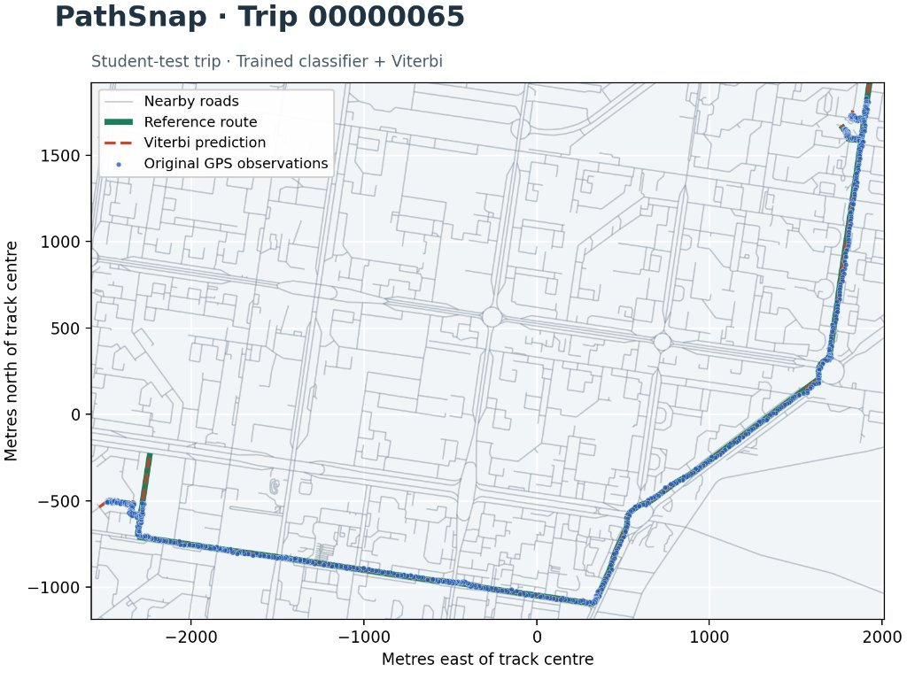

# PathSnap route reconstruction with tuned LightGBM

For the decoder and gap-handling details, see [Sections 5 and 6 of the team report](REPORT_DRAFT.md#5-hmm-and-viterbi-route-reconstruction-person-3).

## Training-only decoder tuning

We refitted LightGBM with the feature list and tuned hyperparameters from the published 16:44 model. We grouped the 80 training trips into 5 folds. For each of eight trips sampled by trip length, we generated classifier probabilities using a model fitted on the other four folds. We searched transition scales of 15, 30, and 60 m and disconnected-transition penalties of 4 and 8. Pooled top-1 selected the configuration, with mean continuity as a tiebreaker. The selected scale was 30 m and the penalty was 8. It scored 97.53% across 19,095 valid tuning observations. This is the score used for parameter selection. These settings match the original Viterbi defaults. The student-test trips were held out of tuning, and the evaluator split was outside this workflow. Sources [hmm_tuning_summary.csv](../results/hmm_tuning_summary.csv) and [hmm_tuning_metadata.json](../results/hmm_tuning_metadata.json).

## Student-test comparison

We used the saved tuned LightGBM scorer trained at 16:44 and published in commit `d1e216b`. The three methods used the same scores across the 10 student-test trips, with 19,133 valid reference assignments out of 19,160 GPS observations. Person 2’s classifier evaluation recorded candidate-level log loss of 0.0668. Source [experiments.csv](../results/experiments.csv).

| Method | Top-1 accuracy | Macro F1 (arc-level) | Route continuity | Sequence similarity |
|---|---:|---:|---:|---:|
| Tuned LightGBM | 90.75% | 85.31% | 96.24% | 73.34% |
| Tuned LightGBM + default Viterbi | 93.31% | 92.60% | 99.43% | 90.73% |
| Tuned LightGBM + retuned Viterbi | 93.31% | 92.60% | 99.43% | 90.73% |

Top-1 pools matches across valid GPS observations. Arc-level macro F1 averages F1 across road segments within each trip, then averages the trip scores. Route continuity measures repeated arcs or directed connections within two steps. Sequence similarity is one minus normalized edit distance after collapsing consecutive duplicate arc IDs. Continuity and sequence similarity are averaged across trips. Source [hmm_student_test_summary.csv](../results/hmm_student_test_summary.csv).

Viterbi raised pooled student-test Top-1 by 2.56 percentage points over tuned LightGBM alone, with gains on all 10 trips. The default and training-selected settings produced identical evaluation scores. Source [hmm_student_test_by_trip.csv](../results/hmm_student_test_by_trip.csv).

The local FastAPI batch evaluator processed the same 10 student-test trips with the tuned model and updated decoder configuration. Its per-trip metrics agree with the comparison after rounding. The table uses exact match counts for pooled Top-1. The API batch console computes pooled Top-1 from rounded per-trip scores. Source [api_eval_student_test.csv](../results/api_eval_student_test.csv).

## Reproduce

From the repository root, set `PATHSNAP_DATA` to the folder containing `train/` and `student_test/`. Run `python -m src.hmm.compare --tune --map-trip 00000065`. Omit `--tune` to reuse the existing HMM config. The earlier logistic-regression run was a baseline. The results here apply to the LightGBM artifact recorded in the tuning metadata.
